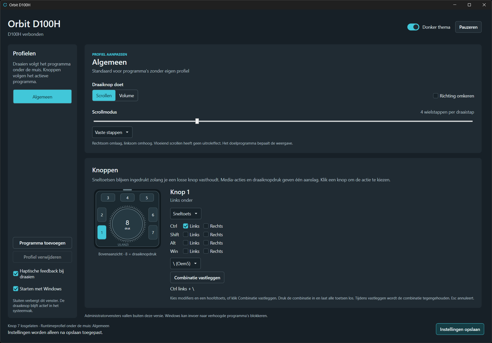

# Orbit D100H

[Nederlands](README.md) · [English](README.en.md)

A Windows app for scrolling, button assignments and profiles for individual
programs. Connects directly over Bluetooth HID, without Ulanzi Studio, driver
installation, an account or an internet connection.

**[Download the Windows app](https://github.com/nsaasman/Orbit-D100H/releases/latest)**



## Choose a language

At the top of the app, choose **Nederlands**, **English**, **Deutsch**,
**Français** or **Español**. The entire interface changes immediately,
including the system tray menu, status messages and shortcut editor. The app
remembers your choice after restarting. Without a saved preference, it follows
the Windows display language; unsupported languages fall back to English.

Changing language preserves the selected button, profile and unsaved edits.
It does not save those edits. Any shortcut recording is cancelled first,
keeping the previous binding and pause state. Profile names, program paths
and the Windows keyboard layout stay unchanged. The display name of the
general profile is translated.

The language preference is separate from profile settings, alongside the theme
preference in `HKEY_CURRENT_USER\Software\D100HControl`, under `Language`.
Windows dialogs and system error details follow Windows. The separate Probe
diagnostic program is not fully translated.

## Download and install

1. Open the [latest release](https://github.com/nsaasman/Orbit-D100H/releases/latest)
   and download `Orbit-D100H-v1.0.0-win-x64.zip`.
2. Extract the complete ZIP to a permanent folder on your own computer.
3. Pair the Ulanzi D100H in Windows using Bluetooth and close Ulanzi Studio.
4. Run **Orbit D100H.exe** from the extracted folder.

The download is for Windows x64 and includes the required .NET runtime.
You do not need to install .NET separately. Keep all files and folders together.
To update, follow the same steps and first close the previous version using
**Exit** in the system tray. Settings are stored outside the program folder
and are preserved.

**Orbit D100H Probe.exe** is a diagnostic program for developers. It is not the
main app and exits after enumerating devices. The normal Windows download
contains the main app.

## Start

Run **Orbit D100H.exe**. If you build from source, the published app is in
`artifacts/Orbit-D100H-win-x64`. Keep the complete distribution folder together:
it includes the required .NET runtime. Close Ulanzi Studio and turn on the
paired D100H. Windows must allow scrolling in inactive windows under the
mouse. The app explains how to enable this setting if needed; it does not
change the setting itself.

Nothing is installed on the device. The connection temporarily uses vendor
mode. After exiting or a process crash, the D100H returns to its standard controls.

The previous name was Orbit / D100HControl. Existing settings and your theme
choice are preserved. If you use **Start with Windows**, save settings once
after replacing the old version: the startup entry will then point to
`Orbit D100H.exe`. Exit the old version through the system tray before
starting the new one.

## Controls

- For each profile, choose **Scroll** or **Volume** under **Dial function**.
  Volume changes the Windows volume by one step per dial step. The speed
  setting only affects scrolling. **Reverse direction** reverses turning for
  the selected function.
- Clockwise scrolls down; counterclockwise scrolls up.
- Choose fixed wheel steps or smooth scrolling. The default is three wheel
  steps per dial step. Windows and the target program determine the number of lines.
- Smooth scrolling spreads the same total movement over at most 96 ms after
  the last dial step, without momentum. Some programs accumulate small
  movements before displaying them, which can make scrolling look less smooth.
- Scroll speed, scroll mode and direction are configurable per profile.
- Click a button on the D100H diagram and choose no action, a keyboard
  shortcut or a media function. The green button is the selected button.
- For **Ctrl**, **Shift**, **Alt** and **Win**, choose left or right separately,
  together with a main key. Existing generic modifiers are preserved unchanged.
- Alternatively, click **Record shortcut**, press the combination and release
  all keys. A temporary Windows keyboard hook captures keys only during
  recording. Plain Escape cancels; Tab can also be recorded. Cancelling,
  closing the window, activating another window or waiting twenty seconds
  ends recording without replacing the previous binding.
- During recording, the D100H performs no actions. Its Bluetooth connection
  stays active. The previous pause state returns afterwards. Outside recording,
  no keyboard hook runs and ordinary keystrokes are neither intercepted nor logged.
- Shortcuts on the seven individual buttons stay pressed while you hold the
  button. Releasing it releases the combination in reverse order. The app
  does not repeat keystrokes. Simultaneous buttons can share modifiers.
- Media actions send one keystroke when pressed. A dial press sends one
  keystroke when released; the device reports that press only on release.
- When the active window changes, the app pauses, the connection is lost,
  settings are saved, recording starts, the screen locks or the app exits,
  it releases held synthetic keys. Release the physical device button and
  press it again to activate its combination.
- Add a program by choosing its `.exe` file. Turning follows the program under
  the mouse; button actions follow the active program. Each profile can have
  its own dial function, speed, direction and button assignments.
- The general profile applies when there is no program-specific profile.
- **Haptic feedback when turning** enables or disables the tactile steps.
  This applies to all profiles after saving. It is enabled by default;
  strength and step density cannot be adjusted. After reconnecting, Orbit
  D100H reapplies your saved choice. You can save while offline: the choice
  takes effect when the dial connects. **Haptic feedback not confirmed**
  means the device did not return the expected response. Scrolling and
  buttons keep working. Change the setting and save again, or reconnect
  the dial, to retry.
- Click **Save settings** to apply edits. Closing a window hides the editor
  and retains unsaved edits in that window.
- **Dark theme** switches immediately between dark and light. The preference
  is saved independently of profile edits. The window adapts to smaller
  spaces and provides vertical scrolling when its contents do not fit.
- **Pause** ignores D100H input while keeping vendor mode active. Other
  volume keys keep working. **Exit** is in the system tray menu.
- **Start with Windows** is off by default. After enabling and saving it,
  the app starts through the current user's startup settings without showing
  a window. For daily use, keep the distribution folder on your own computer.

Settings are stored in `%LOCALAPPDATA%\D100HControl\settings.json`. A corrupt
or invalid file is reported and is not overwritten. If this happens, close
the app, preserve the file and repair it before starting again.

Only one app or diagnostic process can be active at a time. Connection loss
is reported; the app then automatically searches for the device again.
Changing targets, pausing and connection loss discard remaining scroll movement.

Administrator windows are outside this version's supported use. Windows may
block input to elevated processes. The app does not elevate itself automatically.

### Paired, but not connected

A Windows **Paired** entry does not prove an active Bluetooth connection.
The app can connect only when Windows makes the HID collections available.
Check the D100H's power and active host slot.

If it still will not connect, renew only the Windows pairing for **Ulanzi Dial**.
Remove it from Bluetooth devices, hold the device-switch button for three
seconds until its light flashes, then add **Ulanzi Dial** again. The app keeps
searching automatically; its settings stay unchanged. On the test computer,
this restored the missing HID collections.

## Buttons on the diagram

The diagram is an original scalable drawing of the top view. Visible numbers
follow the user's annotated reference image. Internal device codes in saved
assignments are preserved:

| Position | Button |
| --- | --- |
| Top left | 3 |
| Top middle | 4 |
| Top right | 5 |
| Upper left beside the dial | 2 |
| Lower left | 1 |
| Upper right beside the dial | 6 |
| Lower right | 7 |
| Dial press | 8 |

## Build and check

Run these commands in the project folder with a .NET 10 SDK:

```powershell
dotnet build .\OrbitD100H.slnx -c Release
dotnet ".\src\OrbitD100H.Probe\bin\Release\net10.0-windows\Orbit D100H Probe.dll" --self-test
dotnet ".\src\OrbitD100H.UiTests\bin\Release\net10.0-windows\OrbitD100H.UiTests.dll"
dotnet ".\src\OrbitD100H.Probe\bin\Release\net10.0-windows\Orbit D100H Probe.dll" --output .\artifacts\hardware\collections.json
```

Checks cover report decoding, profile selection, button actions, scroll
direction, preservation of total scroll delta, target switching, settings
storage and protection of corrupt files. A delayed test transport also
checks that Bluetooth write time does not extend the keepalive interval.

The UI checks open test windows and verify language changes, unsaved edits,
recording cancellation and both themes at two window widths. They do not
start a HID session or inject keys. They require an interactive Windows
session and access to the user's registry preferences. The original language
and theme preferences are restored afterwards. Add `artifacts\ui-localization`
as an argument to save screenshots.

## Diagnostics and hardware validation

The regression suite also checks translations, language detection and
updating existing messages when changing language. Scrolling, buttons,
haptic feedback and reconnection have been confirmed on the development
system. Recovery after Windows sleep remains untested. Check your own
device using the procedure below.
The diagnostic program does not generate synthetic mouse or keyboard input.
Without `--listen`, it only enumerates matching HID collections.

First exit Orbit D100H through the system tray and close Ulanzi Studio
completely. Turn on the paired D100H, then run:

```powershell
dotnet ".\src\OrbitD100H.Probe\bin\Release\net10.0-windows\Orbit D100H Probe.dll" --listen --seconds 180 --output .\artifacts\hardware\vendor-session.json
```

1. Wait for `Vendor mode bevestigd door keepalive-antwoord.`
2. Turn both ways. Check that the Windows volume stays unchanged.
3. Press and release each of the seven buttons and the dial once.
4. Check that the keyboard's volume keys still work normally.
5. Let the test finish or press `Ctrl+C`. Check that the dial returns to
   controlling standard volume.
6. Repeat after turning the device off and on. Check the connection and
   all events again.
7. Separately check recovery after Windows sleep and after terminating the
   diagnostic process. Save the results and record physical observations.

A keepalive response proves communication. It does not by itself prove that
all controls work or that there are no side effects.

Exit codes: `0` means a completed command, `1` means an error and `2` means
no usable vendor collection was found. Exit code `0` does not automatically
approve the complete hardware test.

The software logs only report IDs, event codes and summaries. Other report
bytes are not stored because they may contain device memory.

A passive check for unwanted volume commands can run alongside the app:

```powershell
dotnet ".\src\OrbitD100H.Probe\bin\Release\net10.0-windows\Orbit D100H Probe.dll" --monitor-consumer --seconds 180 --output .\artifacts\hardware\consumer-save.json
```

This reads only the D100H Consumer Control collection. It does not activate
vendor mode or block Windows input. `02 E9 00` means volume up, `02 EA 00`
means volume down and `02 00 00` means a media key was released.

After connection loss, the app checks for a usable D100H every 250 ms.
Saving preserves the existing HID session. Until Windows makes the Bluetooth
connection available and vendor mode becomes active, the D100H may still
send its standard input. Other volume keys are not blocked.

## Sources

- [HamDial protocol](https://github.com/ftl/hamdial/blob/master/doc/protocol.md)
- [D100H homebrew research](https://github.com/brendanwelsh/ulanzi-d100h-homebrew)
- [OpenLogi product example](https://github.com/AprilNEA/OpenLogi)

See `THIRD-PARTY-NOTICES.md` for the license covering the protocol mapping.

## Contributors

- [Niek Aasman (@nsaasman)](https://github.com/nsaasman) — creator and maintainer.
- [OpenAI Codex](https://openai.com/codex/) — AI assistant for development,
  tests and documentation.

## License

Orbit D100H is available under the [MIT license](LICENSE). Its protocol mapping
is based on HamDial; the attribution is in [THIRD-PARTY-NOTICES.md](THIRD-PARTY-NOTICES.md).
This project is independent and is not affiliated with Ulanzi.

## Publish

Double-click `release.bat` to build the solution in Release mode, run the
automated checks and publish the self-contained Windows x64 app. This
requires the .NET 10 SDK. The script also works from a network path.
Use `release.bat /nopause` in scripts to skip the final pause. On failure,
the script stops with a nonzero exit code. If files are locked, close the
running release using **Exit** in the system tray.

Output is in `artifacts\Orbit-D100H-win-x64`. Distribute that complete folder.
Recipients do not need a separate .NET runtime installation.

You can also run the publish step directly:

```powershell
dotnet publish .\src\OrbitD100H.App\OrbitD100H.App.csproj -c Release -r win-x64 --self-contained true -o .\artifacts\Orbit-D100H-win-x64
```

The app uses WPF, a native system tray menu, and Windows HID and input APIs.
There are no external NuGet dependencies. The distribution targets Windows x64.

For the separate diagnostic program:

```powershell
dotnet publish .\src\OrbitD100H.Probe\OrbitD100H.Probe.csproj -c Release -r win-x64 --self-contained true -o .\artifacts\Orbit-D100H-Probe-win-x64
& ".\artifacts\Orbit-D100H-Probe-win-x64\Orbit D100H Probe.exe" --self-test
```

The complete folder includes the required runtime and license notices.
Recipients do not need a .NET runtime installation. Use `--listen` explicitly
to activate vendor mode; without it, the program only enumerates devices.
